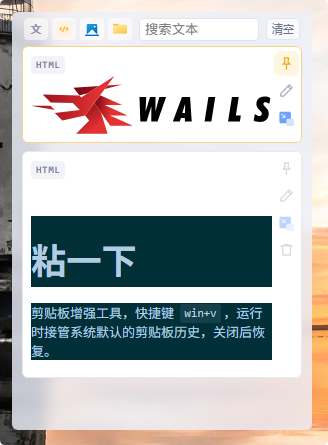

# 粘一下

剪贴板增强工具，快捷键 `win+v`，运行时接管系统默认的剪贴板历史，关闭后恢复。

## 设计思路

### 图片

图片来源分三类：本地文件（部分软件复制图片时会附带临时文件）、网络链接、位图（剪贴板里的 CF_DIB/PNG，截图属于这类）。

**前端拆分**（`+page.svelte`）

剪贴板内容是纯 `` 组成的 HTML 时，按标签拆成多条记录——系统剪贴板一次只能携带一张图片。`src` 经 `localPathReplace` 把本地路径改写成 `/wg/file/...` 再显示。

**写入**（`cb.WriteImage`）

解码一次 → 生成 CF_DIB；原图是 PNG 就写原始字节，其他格式转码成 PNG；PNG 与 DIB 一次会话同时写入，粘贴方按需取，兼容老程序。

**显示**

记录里只存 URL（`cb.URL + "/file/..."`），前端 `` 直接加载，不经过 JS 传二进制。内部地址由 Gin 的 StaticFS 按盘符映射到磁盘，重启后依然有效。

**回写**

按 BUrl 优先级回源：内部 `/file/` 地址读盘、外部链接下载，都没有才回内存缓存；拿到字节后 PNG 原样、其他转码，再编 DIB 写回剪贴板。回源失败时降级为无图，不影响文本等其他成员。

### 持久化

只在钉住时落盘，实时预览不产生磁盘文件。数据目录锚定在可执行文件所在位置。

- **索引**：`local\store`，无后缀的文本文件，内容就是 RecordJs 的 JSON 数组（旧→新），只有文本与 URL，不含二进制。全量重写体积恒定。
- **图片**：`local\imgs\<id>.<真实后缀>`，缩略图 `<id>.thumb.<后缀>`，两者并排存放。
- **文件**：非图片文件的副本放 `local\files\<id>\原名`，保留原名——粘出去的文件名不能变。
- **外部路径**：其他软件的临时文件在钉住时一律拷进自家目录并改写记录里的地址（BUrl 和 files 同步），不再依赖来源文件的生命周期；网络链接只保留 URL。
- **删除**：清掉该记录对应的图片与文件副本，外部文件不碰。
